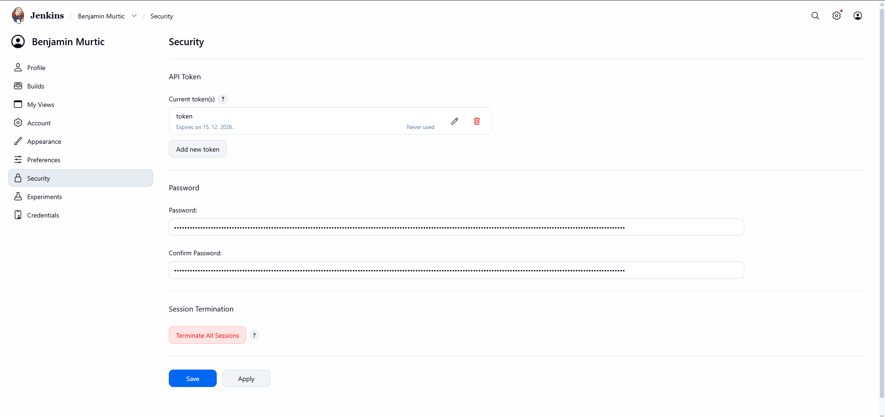
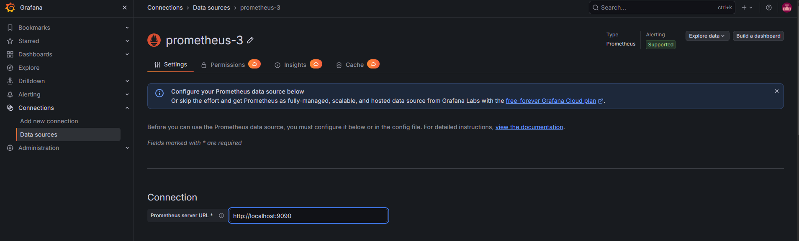
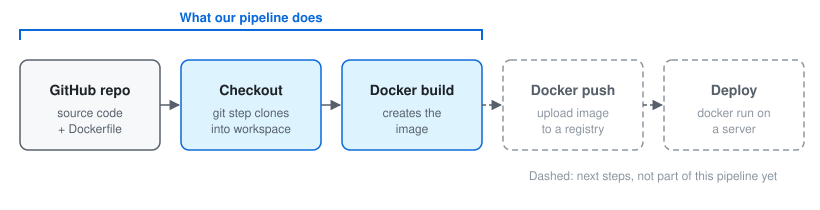
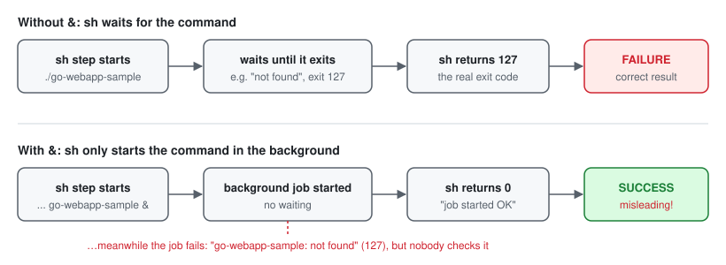
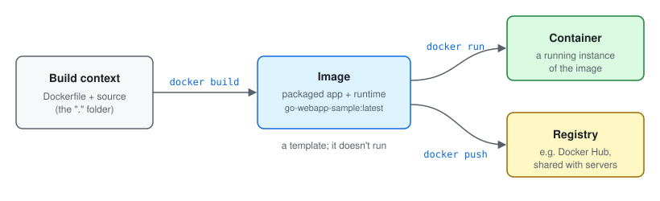
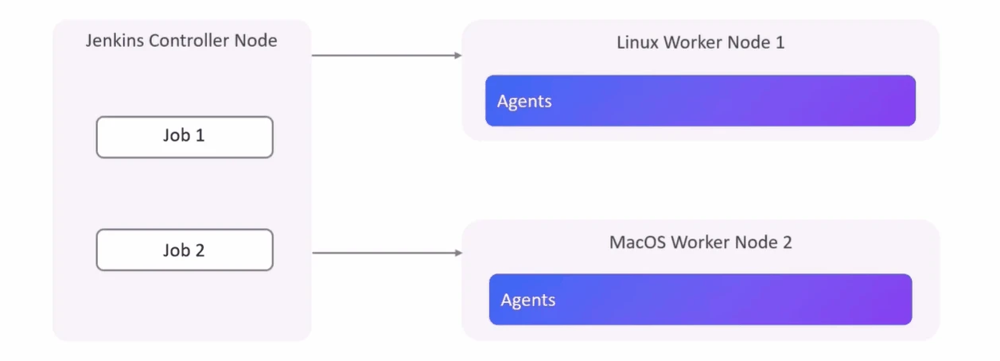
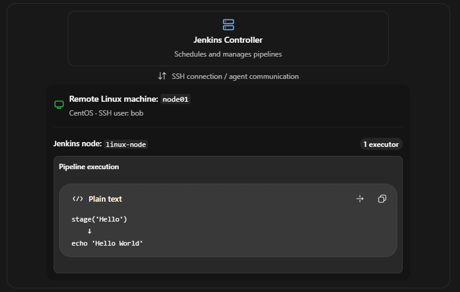
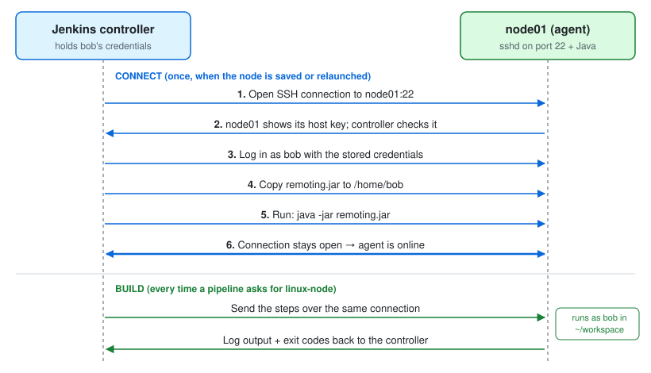
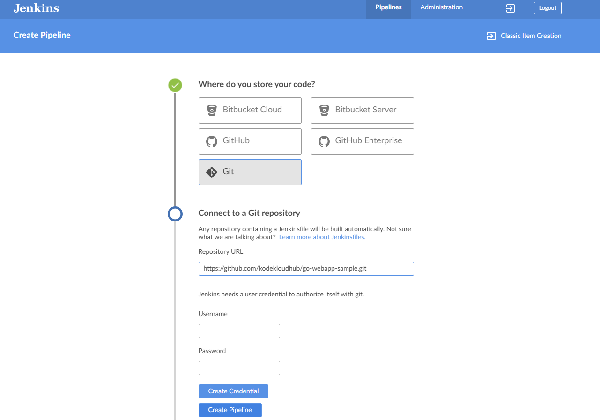

# Jenkins Setup Notes

Personal notes from the KodeKloud Jenkins course: installing and accessing Jenkins, then plugins, permissions, views, monitoring and pipelines, with the reason for each step. These notes grow as the course goes on.

## Contents

1. [Environment](#environment)
2. [Install Java](#1-install-java)
3. [Add the Jenkins package repository](#2-add-the-jenkins-package-repository)
4. [Install, start and unlock Jenkins](#3-install-start-and-unlock-jenkins)
5. [Create an SSH key pair](#4-create-an-ssh-key-pair)
6. [Enable the Jenkins SSH server](#5-enable-the-jenkins-ssh-server)
7. [Add the public key to the Jenkins user](#6-add-the-public-key-to-the-jenkins-user)
8. [Connect to Jenkins over SSH](#7-connect-to-jenkins-over-ssh)
9. [Use the Jenkins CLI](#8-use-the-jenkins-cli)
10. [Plugins](#9-plugins)
11. [Permissions](#10-permissions)
12. [Views](#11-views)
13. [Metrics with Prometheus and Grafana](#12-metrics-with-prometheus-and-grafana)
14. [Pipelines](#13-pipelines)
15. [Agents](#14-agents)
16. [Blue Ocean](#15-blue-ocean)
17. [Troubleshooting](#troubleshooting)
18. [Quick reference](#quick-reference)

---

## Environment

| Component | Value |
|---|---|
| Host OS | Windows 11 |
| Linux | Ubuntu 24.04 LTS on WSL |
| Java | OpenJDK 21 |
| Jenkins | 2.580.2 (LTS, from the official `debian-stable` repo) |
| Jenkins web UI | `http://localhost:8080` |
| Jenkins SSH port | `8088` |
| Working folder | `~/kodekloud` (SSH keys and `jenkins-cli.jar`) |

> **Note:** The course labs use Red Hat-style servers (`yum`, `rpm`). Ubuntu uses `apt` instead, so the lab commands were translated. Both versions are shown where they differ.
>
> Steps 1–8 were done on my local machine. Steps 9–15 were done in the KodeKloud lab environment, where Jenkins listens on port `8085` instead of `8080`.

---

## 1. Install Java

Jenkins is a Java application, so it needs a Java runtime. Jenkins 2.5xx requires **Java 17 or 21**.

```bash
sudo apt update
sudo apt install -y openjdk-21-jdk
```

| Course (yum) | Ubuntu (apt) | Why |
|---|---|---|
| `java-21-openjdk` + `java-21-openjdk-devel` | `openjdk-21-jdk` | On Ubuntu the JDK package contains both the runtime and the developer tools. |

Check it:

```bash
java -version
```

---

## 2. Add the Jenkins package repository

Ubuntu's own repositories don't include Jenkins. You add the official Jenkins repository, plus the key apt uses to check that its packages are genuine.

```bash
# 1. Create the folder for repository signing keys
sudo install -d -m 0755 /etc/apt/keyrings

# 2. Download the Jenkins signing key
sudo curl -fsSL -o /etc/apt/keyrings/jenkins-keyring.asc \
  https://pkg.jenkins.io/debian-stable/jenkins.io-2026.key

# 3. Register the repository, trusting only that key for it
echo "deb [signed-by=/etc/apt/keyrings/jenkins-keyring.asc] https://pkg.jenkins.io/debian-stable binary/" \
  | sudo tee /etc/apt/sources.list.d/jenkins.list > /dev/null

# 4. Refresh the package lists so apt sees the new repository
sudo apt update
```

What changed compared with the course commands:

| Course (yum) | Ubuntu (apt) | Why |
|---|---|---|
| `curl … -o /etc/yum.repos.d/jenkins.repo …/redhat-stable/jenkins.repo` | One `deb …` line in `/etc/apt/sources.list.d/jenkins.list`, pointing at `debian-stable` | yum reads `.repo` files. apt reads `deb` lines, and Jenkins has a separate repository for `.deb` packages. |
| `rpm --import …/jenkins.io-2023.key` | Save the key to `/etc/apt/keyrings/` and reference it with `signed-by=` | apt has no global "import key" step. `signed-by` limits the key to this one repository, which is safer. |
| *(not needed)* | Extra `sudo apt update` | yum refreshes repository data on its own. apt only does it when you run `apt update`. |

> ⚠️ **Signing key changed.** The course uses `jenkins.io-2023.key`. Jenkins has since switched to `jenkins.io-2026.key`. With the old key, `apt update` rejects the repository and `apt install jenkins` fails with *"Package 'jenkins' has no installation candidate"*. If this happens again, the current key filename is listed on [pkg.jenkins.io/debian-stable](https://pkg.jenkins.io/debian-stable/).

---

## 3. Install, start and unlock Jenkins

```bash
sudo apt install -y jenkins
sudo systemctl enable --now jenkins
```

- `apt install jenkins` installs Jenkins as a system service that runs as its own `jenkins` user. Its data lives in `/var/lib/jenkins`.
- `systemctl enable --now` starts Jenkins now (`--now`) and on every boot (`enable`).

Check that it's running:

```bash
systemctl status jenkins
```

**Unlock Jenkins.** On first start, Jenkins creates a one-time admin password so that nobody else can take over a fresh install:

```bash
sudo cat /var/lib/jenkins/secrets/initialAdminPassword
```

Open `http://localhost:8080`, paste the password, install the suggested plugins, and create your admin user (here: `benjamin`).

> **WSL note:** `systemctl` only works when systemd is enabled in WSL. It is on by default in recent Ubuntu WSL installs.

---

## 4. Create an SSH key pair

The key pair lets you log in to Jenkins over SSH without a password. It is used in steps 6–8.

```bash
mkdir -p ~/kodekloud
ssh-keygen -t ed25519 -C jenkins -f ~/kodekloud/jenkins_ed25519 -N ''
chmod 600 ~/kodekloud/jenkins_ed25519
```

| Option | Meaning |
|---|---|
| `-t ed25519` | Key type. Ed25519 is the modern default: short keys, fast, secure. |
| `-C jenkins` | Comment at the end of the public key. It's a label only. |
| `-f …` | Where to save the key. This creates two files: `jenkins_ed25519` and `jenkins_ed25519.pub`. |
| `-N ''` | No passphrase, so the key can be used by tools without anyone typing a password. |
| `chmod 600` | Only you can read the private key. SSH refuses keys that other users can read. |

**Which file is which**

| File | Name | Share it? |
|---|---|---|
| `jenkins_ed25519` | Private key | **Never.** It stays on your machine and proves who you are. |
| `jenkins_ed25519.pub` | Public key | Yes. You give it to the system you want to log in to. |

**What the public key looks like**

```
ssh-ed25519  AAAAC3NzaC1lZDI1NTE5AAAAI…  jenkins
└ key type   └ key data (base64)          └ comment
```

The key data starts with the same characters for every Ed25519 key, because it begins by encoding the key type name. Only the last part is unique to your key.

> **Where the key goes depends on which way the connection runs:**
> - **You → Jenkins** (SSH/CLI login, this guide): the **public** key goes on your Jenkins user.
> - **Jenkins → something else** (GitHub, agents, servers): the **private** key goes into *Manage Jenkins → Credentials* as *SSH Username with private key*, and the public key goes on the other system.

---

## 5. Enable the Jenkins SSH server

Jenkins can run its own SSH server, so you can control it from a terminal. It needs the **SSH server** plugin, and the plugin is **disabled by default**.

1. *Manage Jenkins → Plugins → Available plugins*: install **SSH server**.
2. *Manage Jenkins → Security → SSH Server*: select **Fixed** and set the port to `8088`, then **Save**.

Check it. When the SSH server is running, Jenkins announces its address in an HTTP response header:

```bash
curl -s -D - -o /dev/null http://localhost:8080/login | grep -i x-ssh-endpoint
# X-SSH-Endpoint: localhost:8088
```

`-D -` prints only the response headers, which makes the output easy to `grep`. No output means the SSH server is still disabled.

---

## 6. Add the public key to the Jenkins user

Go to *your user (top right) → Security*.



*Before the SSH server is enabled, this page only shows API Token, Password and Session Termination.*

Once the plugin is installed and the port is enabled (step 5), an **SSH Public Keys** box appears on this page. Paste the contents of the public key and click **Save**:

```bash
cat ~/kodekloud/jenkins_ed25519.pub
```

---

## 7. Connect to Jenkins over SSH

```bash
ssh -i ~/kodekloud/jenkins_ed25519 -l benjamin -p 8088 localhost who-am-i
```

| Part | Meaning |
|---|---|
| `-i …` | Which private key to use. Needed because the key isn't in the default `~/.ssh` folder. |
| `-l benjamin` | Jenkins username (shown in the URL of your profile page). |
| `-p 8088` | Jenkins SSH port, not the normal SSH port 22. |
| `localhost` | Jenkins runs on this machine. |
| `who-am-i` | A Jenkins CLI command. `help` lists all of them. |

Expected output:

```
Authenticated as: benjamin
Authorities:
  authenticated
```

> **`jenkins-server` vs `localhost`:** The course labs use the hostname `jenkins-server`, which only exists on the lab network. Locally it fails with *"Could not resolve hostname"*. Use `localhost`, or add an alias:
> ```bash
> echo "127.0.0.1 jenkins-server" | sudo tee -a /etc/hosts
> ```
> WSL may regenerate `/etc/hosts` on restart. To stop that, add `generateHosts = false` under `[network]` in `/etc/wsl.conf`.

---

## 8. Use the Jenkins CLI

`jenkins-cli.jar` is the official command-line client. Every Jenkins server serves its own matching version:

```bash
cd ~/kodekloud
wget http://localhost:8080/jnlpJars/jenkins-cli.jar
java -jar jenkins-cli.jar -s http://localhost:8080 -version
```

It can log in two ways:

**With the SSH key** (uses the SSH port from step 5):

```bash
java -jar jenkins-cli.jar -s http://localhost:8080 \
  -ssh -user benjamin -i ~/kodekloud/jenkins_ed25519 who-am-i
```

It prints some `INFO` log lines first. Add `2>/dev/null` to hide them.

**With an API token** (works over plain HTTP, no SSH server needed):

```bash
java -jar jenkins-cli.jar -s http://localhost:8080 -auth benjamin:<API_TOKEN> who-am-i
```

Create the token under *your user → Security → API Token → Add new token*. It is shown **only once**, so copy it right away.

> Never commit API tokens or private keys to Git.

---

## 9. Plugins

Jenkins on its own is a small core. Almost everything else (Git, pipelines, SSH, security strategies, metrics) comes from plugins.

**Manage plugins:** *Manage Jenkins → Plugins*

| Tab | Used for |
|---|---|
| **Updates** | Newer versions of plugins you already have. |
| **Available plugins** | Search for and install new plugins. |
| **Installed plugins** | Enable, disable or uninstall plugins. |
| **Advanced settings** | Upload a `.hpi` file by hand, or change the update site. |

After installing, tick **Restart Jenkins when installation is complete and no jobs are running**. Many plugins only load after a restart. To restart by hand, open `http://<jenkins>/safeRestart`, which waits for running builds to finish first.

**Install from the CLI** (handy for scripting):

```bash
java -jar jenkins-cli.jar -s http://localhost:8080 -auth benjamin:<API_TOKEN> \
  install-plugin role-strategy prometheus -restart
```

Installed plugins live in `/var/lib/jenkins/plugins/`, one `.jpi` file and folder per plugin.

**Plugins used in these notes**

| Plugin | ID | Used for |
|---|---|---|
| SSH server | `sshd` | SSH and CLI login with a key (step 5) |
| Matrix Authorization Strategy | `matrix-auth` | Matrix-based permissions (step 10) |
| Role-based Authorization Strategy | `role-strategy` | Role-based permissions (step 10) |
| Prometheus metrics | `prometheus` | Exposes Jenkins metrics for Prometheus (step 12) |

---

## 10. Permissions

By default, every logged-in user can do everything. Permissions decide **who** can do **what**: see jobs, start builds, change configuration, or administer Jenkins.

**Where:** *Manage Jenkins → Security → Authorization*

| Strategy | What it does |
|---|---|
| Anyone can do anything | No security at all. Only for throwaway test setups. |
| Logged-in users can do anything | The default. Anyone with an account is effectively an admin. |
| Matrix-based security | A table of users/groups × permissions for the whole Jenkins. |
| Project-based Matrix Authorization | Same table, plus extra permissions set per job. |
| Role-Based Strategy | Define roles once, then assign users to roles. Scales better. |

**Create test users first:** *Manage Jenkins → Users → Create User*. Then log in as them (in a private browser window) to check that permissions behave as expected.

> ⚠️ **Don't lock yourself out.** Before saving a new strategy, make sure your own admin user has **Overall → Administer**. If you do get locked out, set `<useSecurity>false</useSecurity>` in `/var/lib/jenkins/config.xml`, run `sudo systemctl restart jenkins`, fix the permissions, and turn security back on.

### Matrix-based security

Plugin: **Matrix Authorization Strategy**.

1. Choose **Matrix-based security**.
2. Click **Add user** and enter the username.
3. Tick the permissions for that user, then **Save**.

Common permissions:

| Permission | Allows |
|---|---|
| Overall → Administer | Everything. Only for admins. |
| Overall → Read | Seeing Jenkins at all. Every user needs this. |
| Job → Read | Seeing jobs. |
| Job → Build | Starting builds. |
| Job → Configure | Changing a job's settings. |
| Job → Create / Delete | Creating or deleting jobs. |

With **Project-based Matrix Authorization**, open a job → *Configure* → **Enable project-based security** to give users extra permissions on that job only. These add to the global permissions; they can't take any away.

### Role-based strategy

Plugin: **Role-based Authorization Strategy**.

1. Choose **Role-Based Strategy** and **Save**.
2. Go to *Manage Jenkins → Manage and Assign Roles → Manage Roles* and create roles:
   - **Global roles** apply to all of Jenkins, for example `admin` (Administer) or `viewer` (Overall → Read).
   - **Item roles** apply to jobs whose name matches a **pattern** (a regular expression). For example, role `developer` with pattern `dev-.*` and the Job → Build and Read permissions applies to every job starting with `dev-`.
3. Go to *Assign Roles*, add the users, and tick their roles.

> A user needs a **global** role with **Overall → Read**, otherwise they can't see Jenkins even if an item role would give them jobs.

**Matrix or roles?** Matrix is quick for a handful of users. Roles are easier to maintain with many users or jobs, because you change a role once instead of every user's row.

---

## 11. Views

Views are tabs on the Jenkins dashboard that group jobs, so a long job list stays manageable. The default view **All** shows every job.

**Create a view:** click **+** next to the view tabs (or *New View*), enter a name, and pick a type:

| Type | Shows |
|---|---|
| **List View** | The jobs you pick, or all jobs matching a regular expression. |
| **My View** | All jobs the current user has access to. |

For a List View, choose the jobs under **Job Filters**, either by ticking them or with **Use a regular expression to include jobs into the view** (for example `dev-.*`). Under **Columns** you choose what's shown per job (status, weather, last success, and so on).

To change or remove a view, open it and use **Edit View** or **Delete View**. Deleting a view never deletes its jobs.

---

## 12. Metrics with Prometheus and Grafana

The three tools each do one job:

```
Jenkins (Prometheus plugin) ──► Prometheus ──► Grafana
   exposes metrics at          collects and      shows them
   /prometheus/                stores them       on dashboards
```

### Jenkins: expose metrics

1. Install the **Prometheus metrics** plugin (step 9) and restart Jenkins.
2. Jenkins now serves its metrics at `http://<jenkins>/prometheus/`. Open it in a browser to check: you should see plain-text lines such as `jenkins_executor_count_value`.

The path and how often metrics are collected can be changed under *Manage Jenkins → System → Prometheus*.

### Prometheus: collect the metrics

Prometheus **scrapes** (fetches) metrics from each target at a fixed interval and stores them. Which targets to scrape is set in `/etc/prometheus/prometheus.yml`:

```yaml
global:
  scrape_interval: 15s          # default: scrape every 15 seconds

scrape_configs:
  - job_name: 'Prometheus'      # Prometheus monitors itself
    scrape_interval: 5s         # overrides the default for this job
    static_configs:
      - targets: ['localhost:9090']

  - job_name: 'Jenkins'
    metrics_path: /prometheus/  # Jenkins plugin path; the default would be /metrics
    static_configs:
      - targets: ['localhost:8085']   # Jenkins host:port in the lab
```

| Key | Meaning |
|---|---|
| `scrape_interval` | How often to fetch metrics. Set globally, can be overridden per job. |
| `job_name` | A label for the target group. It shows up in queries as `job="Jenkins"`. |
| `metrics_path` | URL path of the metrics page. Needed for Jenkins because it isn't `/metrics`. |
| `targets` | `host:port` to scrape. Only the address, without `http://` or the path. |

YAML is indentation-sensitive: each `- job_name` must start at the same column, and nested keys use spaces, never tabs. Check the file, then restart Prometheus to load it:

```bash
promtool check config /etc/prometheus/prometheus.yml
sudo systemctl restart prometheus
```

**Verify:** open `http://localhost:9090/targets` (*Status → Targets*). Both jobs should show **UP**. In the query box, `up{job="Jenkins"}` should return `1`.

### Grafana: visualise the metrics

Grafana reads from Prometheus and draws dashboards. It runs on port `3000`; the first login is `admin` / `admin`, and you're asked to set a new password.

**1. Add Prometheus as a data source:** *Connections → Data sources → Add new data source → Prometheus*. Set **Prometheus server URL** to `http://localhost:9090`, then click **Save & test** at the bottom of the page.



`localhost` works here because Grafana and Prometheus run on the same machine. Otherwise, use the Prometheus server's hostname or IP.

**2. Build or import a dashboard:**
- **Import:** *Dashboards → New → Import*, enter a dashboard ID from [grafana.com/grafana/dashboards](https://grafana.com/grafana/dashboards/) (search for "Jenkins"), and select the Prometheus data source.
- **Build:** *Dashboards → New → New dashboard → Add visualization*, pick the data source and enter a query, for example `jenkins_executor_count_value` or `jenkins_job_count_value`.

---

## 13. Pipelines

A **pipeline** describes a whole build process (get the code, test it, build it, ship it) as code, instead of clicking it together in the UI. Because it's code, it can be versioned in Git as a `Jenkinsfile`.

The goal in this lesson: check out a Go web app from GitHub, test it, and build a Docker image from it.



### Prerequisites

| What | Why |
|---|---|
| **Pipeline** plugin | Adds the *Pipeline* job type and the pipeline syntax. It's part of the suggested plugins at setup. |
| **Git** plugin | Provides the `git` step used to check out code. Also part of the suggested plugins. |
| Go on the Jenkins machine | Needed for `go test`. Otherwise the step fails with `go: not found`. |
| Docker on the Jenkins machine | Needed for `docker build`. |
| `jenkins` user in the `docker` group | Jenkins runs builds as the `jenkins` user, which may not use Docker by default. |

```bash
sudo usermod -aG docker jenkins
sudo systemctl restart jenkins   # group changes only apply after a restart
```

### Create a pipeline job

1. *Dashboard → New Item*, enter a name (e.g. `go-test`), choose **Pipeline**, click **OK**.
2. Scroll to **Pipeline**, keep **Definition: Pipeline script**, and paste the script.
3. **Save**, then **Build Now**. The output is under the build number → **Console Output**.

Instead of pasting the script, **Pipeline script from SCM** reads a `Jenkinsfile` from a Git repository. That's the usual way in real projects.

> **Tip:** The **Pipeline Syntax** link below the script box generates snippets for any step, so you don't have to remember the exact syntax.

### Structure of a declarative pipeline

```groovy
pipeline {                       // everything lives inside this block
    agent { ... }                // where to run: which node / workspace
    environment { ... }          // environment variables for all stages
    stages {                     // required wrapper around all stages
        stage('Name') {          // one named phase, shown in the UI
            steps {              // the actual commands of that stage
                ...
            }
        }
    }
}
```

| Block | Required | Purpose |
|---|---|---|
| `pipeline` | yes | Marks a declarative pipeline. |
| `agent` | yes | Which machine (node) runs the build. `any` means any available one. |
| `environment` | no | Variables available to every step, e.g. `GO111MODULE = 'on'`. |
| `stages` | yes | Holds all `stage` blocks. A `stage` placed directly in `pipeline {}` is a syntax error. |
| `stage('…')` | yes | A named phase. Each stage shows up as its own column in the build view. |
| `steps` | yes | The commands of a stage, such as `git` and `sh`. |

### The `git` and `sh` steps

```groovy
steps {
    git 'https://github.com/kodekloudhub/go-webapp-sample.git'
    sh 'go test ./...'
}
```

- **`git '<url>'`** is a Jenkins step from the Git plugin, not the shell command. It clones the repository into the job's workspace, or fetches and checks out the latest commit if it's already there. That's why there's no `git clone`. Unlike a shell `git clone`, it also works with Jenkins credentials for private repositories.
- **`sh '<command>'`** runs a shell command on the agent. `go test ./...` runs the tests in all packages below the current folder.

| Written in the pipeline | What runs |
|---|---|
| `git 'URL'` | Jenkins Git step: clone/fetch + checkout, managed by Jenkins |
| `sh 'git clone URL'` | Plain Git CLI command in a shell, nothing managed by Jenkins |

### Exit codes decide SUCCESS or FAILURE

Jenkins doesn't read error messages in the log. A `sh` step **fails only if its command returns a non-zero exit code**.

The course's run stage used:

```groovy
sh 'cd /var/lib/jenkins/workspace/go-full-pipeline && go-webapp-sample &'
```

| Operator | Meaning |
|---|---|
| `&&` | Run the next command only if the previous one succeeded. |
| `&` (at the end) | Start the whole command in the **background** and return immediately. |

The log showed `go-webapp-sample: not found`, yet the build ended with **SUCCESS**:



The fix:

```groovy
sh '''
    cd /var/lib/jenkins/workspace/go-full-pipeline
    ./go-webapp-sample
'''
```

- Without the `&`, `sh` waits for the program and returns its real exit code, so a failure now fails the build.
- `./` runs the file from the current folder. Without it, Linux only searches the folders in `$PATH`, which don't include the current folder. That's why it was "not found".
- `'''…'''` lets a `sh` step span several lines.

Jenkins also stops processes a build left running once the build ends, so `&` isn't a way to keep a web app running. Use Docker or `systemd` for that.

### Pipeline: checkout and build a Docker image

The final script from the course:

```groovy
pipeline {
    agent {
        label {
            label 'master'
            customWorkspace "${JENKINS_HOME}/${BUILD_NUMBER}/"
        }
    }
    environment {
        GO111MODULE = 'on'
    }
    stages {
        stage('Checkout') {
            steps {
                git 'https://github.com/kodekloudhub/go-webapp-sample.git'
            }
        }
        stage('Build Image') {
            steps {
                sh 'docker build -t adminturneddevops/go-webapp-sample .'
            }
        }
    }
}
```

| Part | Meaning |
|---|---|
| `label 'master'` | Run on the node with the label `master`, the Jenkins controller in the lab. Newer Jenkins versions call it `built-in`. |
| `customWorkspace "${JENKINS_HOME}/${BUILD_NUMBER}/"` | Use a separate folder per build, e.g. `/var/lib/jenkins/6`, instead of the default `/var/lib/jenkins/workspace/<job>`. The log shows `Running in /var/lib/jenkins/6`. |
| `GO111MODULE = 'on'` | Turns on Go modules for dependency handling. The name must be all caps: environment variables are case-sensitive, so the course's `Go111MODULE` is simply ignored (harmless here, because modern Go uses modules by default). |
| `stage('Checkout')` | Clones the repo into the workspace. |
| `stage('Build Image')` | Builds a Docker image from the `Dockerfile` in that repo. |

> **`label { }` vs `node { }`:** The Jenkins docs show `customWorkspace` inside `agent { node { label '…'; customWorkspace '…' } }`. The `label { }` form above also worked in the lab, as the build log shows. Simpler still is to leave out `customWorkspace` and let Jenkins manage the workspace.

### What `docker build` does

```bash
docker build -t adminturneddevops/go-webapp-sample .
```

| Part | Meaning |
|---|---|
| `docker build` | Build an image from a `Dockerfile`. |
| `-t adminturneddevops/go-webapp-sample` | Name (tag) the image. Format `<docker-hub-user>/<name>`. Without `:version`, the tag is `latest`. |
| `.` | The **build context**: the current folder (the workspace with the cloned repo). Docker reads the `Dockerfile` from there and can copy these files into the image. |

The repo's `Dockerfile`, step by step (the log shows these as `Step 1/7` … `Step 7/7`):

```dockerfile
FROM golang:latest          # start from an image that has Go installed
RUN mkdir /app              # create a folder inside the image
ADD . /app                  # copy the build context (source code) into it
WORKDIR /app                # run the following commands in /app
RUN go build -o main .      # compile the app into a binary called main
EXPOSE 8080                 # document that the app listens on port 8080
CMD [ "/app/main" ]         # what runs when a container starts
```

`RUN go build` is where the Go code is actually compiled; that's why the log shows Go downloading dependencies. The build ends with:

```
Successfully built b8538379762a
Successfully tagged adminturneddevops/go-webapp-sample:latest
```

### Image vs container



The pipeline **only builds the image**. It doesn't start the app and doesn't upload anything.

```bash
docker images                                    # list local images
docker run -d --name go-webapp -p 8080:8080 \
  adminturneddevops/go-webapp-sample:latest      # start a container
docker push adminturneddevops/go-webapp-sample:latest   # upload (needs docker login)
```

- `-d` runs the container in the background (detached).
- `-p 8080:8080` maps port 8080 on the host to port 8080 in the container.
- `docker push` only works for a Docker Hub account you can log in to, here `adminturneddevops`.

---

## 14. Agents

So far every build ran on the Jenkins server itself. With **agents**, the server only coordinates, and other machines do the actual work.

| Term | Meaning |
|---|---|
| **Controller** | The Jenkins server: UI, configuration, scheduling. Hands builds to agents. |
| **Agent** | A machine (server, VM, container) that runs builds for the controller. |
| **Node** | Any machine registered in Jenkins, including the controller. Has a name and labels. |
| **Executor** | A build slot on a node. 1 executor = 1 build at a time. |
| **Label** | A tag on a node, used by pipelines to choose where they run. |

The controller hands each job to a worker node that fits it, e.g. a Linux job to a Linux node and a macOS job to a macOS node. The agent on that node runs it:



The bigger picture:


- **Controller node:** holds everything that defines Jenkins: plugins, jobs, the list of nodes, credentials and configuration. It decides what runs where but ideally runs no builds itself.
- **Worker nodes:** do the work. Each runs an **agent** process with one or more **executors** (build slots). The Linux node with two executors can run two builds at once.
- **How they connect:**
  - **SSH:** the controller logs in to the node and starts the agent. This is what the lab uses (see *How Jenkins launches an SSH agent* below).
  - **JNLP** (inbound agent): the node starts the agent itself and connects to the controller. Common for Windows machines, which usually don't run an SSH server.
  - **Docker / Kubernetes agents:** no permanent machine. Jenkins starts a container or pod for the build and removes it afterwards (see *Docker containers as agents* below).

In the lab, the remote machine is a CentOS host called `node01` with a Linux user `bob`. In Jenkins it's registered as the node `linux-node`:



**Why bother?** The controller stays light and safe, builds can run in parallel on several machines, and each project gets a machine with the right tools (Go, Docker, Windows, …).

### 1. Install the SSH Build Agents plugin

*Manage Jenkins → Plugins → Available plugins →* **SSH Build Agents**. It lets the controller log in to a machine over SSH and start the agent process there. Nothing has to be installed on the agent except Java.

### 2. Prepare the agent machine

```bash
ssh bob@node01             # log in to the future agent
sudo yum install java-17 -y   # CentOS; on Ubuntu: sudo apt install openjdk-17-jre
java -version              # check
```

The agent process is a Java program (`remoting.jar`) that Jenkins copies over and starts, so **Java is the only hard requirement**. Its version must be one your controller supports; Java 17 worked in the lab. The machine also needs a running SSH server reachable from the controller.

Java alone doesn't install build tools. If a pipeline runs `go` or `docker` on this agent, those must be installed on `node01` too.

### 3. Add credentials for bob

*Manage Jenkins → Credentials → System → Global credentials → Add Credentials*

| Field | Value |
|---|---|
| Kind | Username with password |
| Scope | Global |
| Username | `bob` |
| Password | bob's Linux password |
| ID | e.g. `node01-ssh` (optional, makes it easier to find) |

Jenkins stores the password encrypted and uses it to SSH into `node01`. In real setups, prefer **SSH Username with private key**, the same idea as step 4.

### 4. Create the node

*Manage Jenkins → Nodes → New Node →* name `linux-node`, type **Permanent Agent**.

| Setting | Value | Why |
|---|---|---|
| Number of executors | `1` | One build at a time on this machine |
| Remote root directory | `/home/bob` | Where Jenkins puts the agent files and workspaces; bob must be able to write here |
| Labels | *(empty)* | The node name works as a label anyway |
| Usage | Only build jobs with label expressions matching this node | Only jobs that ask for this node run here |
| Launch method | Launch agents via SSH | Uses the plugin from step 1 |
| Host | `node01` | Hostname the **controller** connects to |
| Credentials | `bob/******` | From step 3 |
| Host Key Verification Strategy | Manually trusted key | Checks node01's SSH host key |
| Availability | Keep this agent online as much as possible | Reconnects automatically |

After **Save**, Jenkins connects to `node01` and starts the agent (see next part). Check *Nodes → linux-node → Log*; the end should say the agent is connected and online.

### How Jenkins launches an SSH agent

> **Key point:** An SSH agent doesn't start itself. The **controller logs in to the agent machine over SSH**, like you would by hand, and starts the agent program there. That's why the node needs a hostname, credentials and Java.



1. **The controller opens the connection.** Traffic goes from the controller to port 22 on `node01`. `node01` never has to reach Jenkins and needs no Jenkins password.
2. **Host key check.** Before sending a password, the controller checks `node01`'s SSH host key, the same as the "Are you sure you want to continue connecting?" prompt on a first `ssh`. This stops Jenkins from sending bob's password to the wrong machine. The *Host Key Verification Strategy* setting controls this.
3. **Login with credentials.** The controller logs in as `bob` with the credentials from part 3. Jenkins stores them encrypted under `JENKINS_HOME`; jobs refer to them by ID and never see the password. Wrong credentials means no login, so no agent.
4. **Copy the agent program.** Jenkins copies `remoting.jar` into the *Remote root directory* (`/home/bob`), so bob needs write access there.
5. **Start the agent.** Jenkins runs `java -jar remoting.jar` over SSH. That's why **Java is the only requirement** on `node01`: there's no Jenkins installation there, just this one Java process the controller started.
6. **The SSH connection stays open.** Controller and agent talk through it. It's opened once, not once per build.

### What happens when a build runs

When a pipeline asks for `agent { label "linux-node" }`, the controller sends the steps down that **already open** SSH connection. The agent process runs them:

- **as `bob`, with bob's Linux permissions.** That's why `sh 'whoami'` prints `bob`. Whatever bob can't do (write to `/opt`, use Docker without being in the `docker` group, …), the build can't do either.
- **in `/home/bob/workspace/<job-name>`**, under the remote root directory.
- Log output and exit codes go back to the controller, which shows them in the console and decides SUCCESS or FAILURE (see step 13).

If the connection drops (network problem, reboot, bob's password changed), the node shows **offline** and builds that need `linux-node` wait in the queue. With *Keep this agent online as much as possible*, Jenkins repeats steps 1–5 to reconnect.

### Two kinds of SSH in these notes

They go in opposite directions:

| | Steps 4–7 (Jenkins SSH server) | Step 14 (SSH agent) |
|---|---|---|
| Who connects | **You** → Jenkins | **Jenkins** → `node01` |
| Port | `8088` (Jenkins' built-in SSH server) | `22` (the machine's normal `sshd`) |
| Logs in as | A Jenkins user (`benjamin`) | A Linux user (`bob`) |
| Authenticates with | Your key, added to your Jenkins user | Credentials stored in Jenkins |
| Purpose | Run Jenkins CLI commands | Start the agent and run builds |

> **The other direction:** Jenkins also has *inbound* agents, where the agent machine starts `java -jar agent.jar` itself and connects **to** the controller with a secret. That's used when the controller can't reach the agent, for example behind a firewall. The course uses SSH launching.

### 5. Run a pipeline on the agent

```groovy
pipeline {
    agent {
        label "linux-node"   // run on a node matching this label
    }
    stages {
        stage('Hello') {
            steps {
                echo 'Hello World'
            }
        }
    }
}
```

`agent { label "linux-node" }` means: *find a free executor on a node with this label and run the pipeline there.* The console shows where it ran:

```
Running on linux-node in /home/bob/workspace/<job-name>
...
Hello World
Finished: SUCCESS
```

Two names, two jobs:

| Name | What it is | Used by |
|---|---|---|
| `node01` | The machine's real hostname | SSH (the node's **Host** field) |
| `linux-node` | The node's name inside Jenkins | Pipelines (`label`) |

`echo` is a Jenkins step that only prints to the log. To prove the build really runs on `node01`, use shell commands:

```groovy
steps {
    sh 'hostname'   // node01
    sh 'whoami'     // bob
    sh 'pwd'        // /home/bob/workspace/<job-name>
}
```

### Different stages on different agents

With `agent none` at the top, each stage picks its own agent:

```groovy
pipeline {
    agent none
    stages {
        stage('Build Go') {
            agent { label 'linux-node' }
            steps { sh 'go version' }
        }
        stage('Build Docker') {
            agent { label 'docker-node' }
            steps { sh 'docker version' }
        }
    }
}
```

### Docker containers as agents

Instead of a permanent machine, a pipeline can run inside a **throwaway Docker container**:

```groovy
pipeline {
    agent {
        docker { image 'golang:latest' }   // run all stages inside this image
    }
    stages {
        stage('Development') {
            steps {
                git 'https://github.com/AdminTurnedDevOps/go-webapp-sample.git'
                sh 'go version'
            }
        }
    }
}
```

What Jenkins does:

1. Picks a node that has Docker (here the controller, or any agent).
2. Pulls `golang:latest` if it isn't there yet.
3. Starts a container from it and mounts the job's workspace into it.
4. Runs every step **inside the container**. `go version` works although Go isn't installed on the node, because the image has it.
5. Stops and removes the container when the build ends. The workspace (cloned code) stays on the node.

| | SSH agent (`label`) | Docker agent (`docker`) |
|---|---|---|
| Machine | Permanent, set up once | New container per build |
| Tools | Installed on the machine by hand | Come with the image |
| Clean state | Leftovers from earlier builds | Fresh every time |
| Needs | Java + SSH on the machine | Docker on the node, **Docker Pipeline** plugin |

**Requirements:**
- The **Docker Pipeline** plugin (*Manage Jenkins → Plugins*). Without it the pipeline fails with `Invalid agent type "docker"`.
- Docker installed on the node that runs the build, and the `jenkins` user in the `docker` group (same as step 13).

Useful options:

```groovy
agent {
    docker {
        image 'golang:1.22'          // pin a version instead of latest
        label 'linux-node'           // which node should start the container
        args  '-v /tmp/go:/go'       // extra docker run options, e.g. a cache volume
    }
}
```

Like `label`, `docker` also works per stage, for example with `agent none` at the top, so one stage builds in `golang` and another tests in a different image.

> **Good practice:** Set the controller's executors to `0` (*Nodes → Built-In Node → Configure*) so builds only run on agents. Use SSH keys instead of passwords, a dedicated agent folder like `/home/bob/jenkins-agent`, and verify the host key on first connect.

---

## 15. Blue Ocean

**Blue Ocean** is a plugin that adds a second, more modern UI to Jenkins, built around pipelines. The jobs are the same; it's just a different way to create and look at them.

| Classic UI | Blue Ocean |
|---|---|
| Console log as one long text | Pipeline drawn as stages; click a stage to see only its steps and logs |
| Create jobs via *New Item* and forms | Wizard: pick where the code lives, Jenkins sets up the job |
| One job per branch, set up by hand | Every branch with a `Jenkinsfile` is built automatically |

### Install and open

1. *Manage Jenkins → Plugins → Available plugins →* **Blue Ocean** (it pulls in its dependencies), then restart Jenkins.
2. Click **Open Blue Ocean** in the left sidebar, or go to `http://<jenkins>/blue`.
3. **Classic Item Creation** / the exit icon at the top right takes you back to the normal UI.

### Create a pipeline from a Git repository

*Pipelines → New Pipeline*:



1. **Where do you store your code?** Choose **Git** for any Git URL. The GitHub/Bitbucket options log in to that service with an access token and let you pick from your repositories.
2. **Repository URL:** `https://github.com/kodekloudhub/go-webapp-sample.git`
3. **Username / Password:** only needed for private repositories. **Create Credential** saves them in Jenkins' credentials store (like step 14).
4. **Create Pipeline.**

The pipeline is defined by the **`Jenkinsfile`** in the repository, not in Jenkins. Blue Ocean creates a **Multibranch Pipeline** job: it scans the repository, finds every branch that has a `Jenkinsfile`, and runs a build for each. A repository without a `Jenkinsfile` produces no builds.

That's the main difference to step 13, where the script was pasted into the job:

| | Script in the job (step 13) | `Jenkinsfile` in the repo (Blue Ocean) |
|---|---|---|
| Where the pipeline lives | Jenkins job configuration | Git, next to the code |
| Versioned / reviewed | No | Yes, with every commit |
| Branches | One job, one branch | Each branch builds automatically |

> **Note:** Blue Ocean is in maintenance mode and gets no new features. For the stage view in the classic UI, Jenkins now recommends the **Pipeline Graph View** plugin. Blue Ocean still works and is what the course uses.

---

## Troubleshooting

| Symptom | Cause | Fix |
|---|---|---|
| `yum: command not found` / can't install yum | Ubuntu uses `apt`, not `yum` | Translate the commands (see steps 1–2). |
| `Package 'jenkins' has no installation candidate` | `apt update` rejected the Jenkins repository, usually because the signing key is outdated | Download the current key (step 2), then `sudo apt update`. |
| No **SSH Public Keys** box on the user Security page | SSH server plugin missing or not loaded | Install **SSH server**, enable the port, restart Jenkins if needed (step 5). |
| `curl … \| grep x-ssh-endpoint` prints nothing | SSH port is set to **Disabled** | *Manage Jenkins → Security → SSH Server → Fixed* (step 5). |
| `Could not resolve hostname jenkins-server` | Lab-only hostname | Use `localhost` or add an `/etc/hosts` alias (step 7). |
| `Permission denied (publickey)` | Public key not saved on the Jenkins user, or wrong username | Paste the `.pub` key into the user's Security page and check the username (step 6). |
| Locked out after changing the authorization strategy | Your user has no **Overall → Administer** | Set `<useSecurity>false</useSecurity>` in `/var/lib/jenkins/config.xml` and restart Jenkins (step 10). |
| User can log in but sees nothing | No **Overall → Read** permission / no global role | Give them Overall → Read, or a global role that has it (step 10). |
| Prometheus doesn't start after editing the config | YAML error, often wrong indentation or a missing `]` | Run `promtool check config /etc/prometheus/prometheus.yml` (step 12). |
| Jenkins target is **DOWN** in Prometheus | Wrong port, missing `metrics_path`, or the plugin isn't installed | Open `http://<jenkins>/prometheus/` in a browser and match the config to it (step 12). |
| Pipeline fails to start with a syntax error | A `stage` outside of `stages { }`, or a missing brace | Wrap all stages in `stages { }` (step 13). |
| Build shows **SUCCESS** although the log has an error | The command was started in the background with `&`, so `sh` returned `0` | Remove the `&` (step 13). |
| `go-webapp-sample: not found` | The program isn't in `$PATH` | Run it with `./go-webapp-sample` from its folder (step 13). |
| `go: not found` | Go isn't installed on the Jenkins machine | Install Go on the agent (step 13). |
| `permission denied … /var/run/docker.sock` | The `jenkins` user can't use Docker | `sudo usermod -aG docker jenkins`, then restart Jenkins (step 13). |
| Agent stays offline, log says `java: command not found` | Java isn't installed on the agent | `sudo yum install java-17 -y` on the agent, then *Relaunch agent* (step 14). |
| Agent log shows an SSH authentication failure | Wrong username/password in the credentials | Test `ssh bob@node01` by hand, then fix the credentials (step 14). |
| `Invalid agent type "docker" specified` | Docker Pipeline plugin not installed | Install **Docker Pipeline** and run the build again (step 14). |
| Blue Ocean pipeline created but nothing builds | No `Jenkinsfile` in the repository (or not in the root folder) | Add a `Jenkinsfile` to the branch and rescan the repository (step 15). |
| Build waits forever: *Waiting for next available executor* | No online node has the requested label, or all executors are busy | Check the label in `agent { label … }` matches the node name and the node is online (step 14). |

---

## Quick reference

```bash
# Service
sudo systemctl status jenkins
sudo systemctl restart jenkins

# Initial admin password
sudo cat /var/lib/jenkins/secrets/initialAdminPassword

# Is the SSH server on?
curl -s -D - -o /dev/null http://localhost:8080/login | grep -i x-ssh-endpoint

# SSH login test
ssh -i ~/kodekloud/jenkins_ed25519 -l benjamin -p 8088 localhost who-am-i

# CLI over SSH
java -jar ~/kodekloud/jenkins-cli.jar -s http://localhost:8080 \
  -ssh -user benjamin -i ~/kodekloud/jenkins_ed25519 help

# Safe restart (waits for running builds)
#   http://<jenkins>/safeRestart

# Prometheus: check config, reload, see targets
promtool check config /etc/prometheus/prometheus.yml
sudo systemctl restart prometheus
#   http://localhost:9090/targets

# Jenkins metrics endpoint
curl -s http://localhost:8085/prometheus/ | head

# Let Jenkins use Docker
sudo usermod -aG docker jenkins && sudo systemctl restart jenkins

# Docker: list images, run, push
docker images
docker run -d -p 8080:8080 adminturneddevops/go-webapp-sample:latest
docker push adminturneddevops/go-webapp-sample:latest

# Agent machine: log in, install Java
ssh bob@node01
sudo yum install java-17 -y && java -version
```
